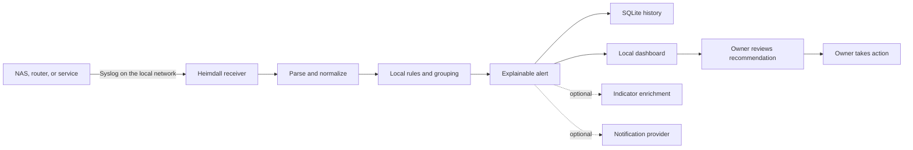

# Heimdall: Home Security Overview

## College milestone scope amendment

Owner update, 2026-11-04: implement the shell monitor with a local browser dashboard for alert review, monitor control and validated configuration. [ADR 0003](docs/adr/0003-shell-monitor-with-local-dashboard.md) extends the earlier terminal-only decision: shell/jq owns parsing, rules and state, while a Python standard-library HTTP bridge provides authenticated local access. The shell monitor and dashboard are deployed on blue, with boot/crash recovery verified; service-aware controls, daily cleanup and real scheduled Discord delivery were verified on November 17 ([current status](docs/status.md)); the broader architecture below remains future direction. See the [runbook](docs/runbook.md) and [runtime contract](docs/runtime-contract.md). Faculty questions and the separate SSH-blocking approval/recovery gate remain open.

The current college milestone uses shell scripts, commands, a local browser dashboard, local files and two Ubuntu ARM64 VMs; a terminal menu remains optional. Its ten-day delivery priorities and planned behavior are recorded in [the college milestone plan](docs/college-milestone-plan.md) and [ADR 0002](docs/adr/0002-shell-first-college-milestone.md). Those documents govern this milestone where they differ from the broader architecture below. The supplied evaluation rubric is mapped in [evaluation alignment](docs/evaluation-alignment.md); the supplied idea template is recorded there, while its applicability to the final report, title-page dates and any separate course requirements remain open for faculty confirmation. Automatic SSH source blocking is a last-priority, VM-only proposal that requires detailed design review and tested recovery before activation. The remaining sections describe the broader product direction, not implemented capabilities.

## Product direction

Heimdall is a planned, local-first security assistant for personal home systems: NAS devices, routers, and a small number of services hosted at home. It should help an owner answer three questions:

1. What happened?
2. Why does Heimdall think it matters?
3. What is a sensible next step?

The product goal is **a clear, local security overview for a home server or NAS, without running a full SOC stack**. Heimdall combines selected strengths of security monitoring, indicator enrichment, incident history, and workflow notification in a small, understandable package.

This is the broader product blueprint. The shell-first college milestone now implements SSH collection, local rules, file persistence and a dashboard. Its current status is recorded in README and the milestone checklist; the NAS/router architecture below remains planned.

## Audience and problem

The primary user is a technically curious home-server or NAS owner who wants more context than isolated device alerts provide, but does not want to deploy and maintain a full enterprise security platform. A home setup may include a NAS, router, media server, backup service, and a few containers. Relevant events are scattered across their logs and admin screens.

Heimdall will collect selected security events, group related activity, explain local detection rules, and keep a searchable local record. It aims to reduce the effort of checking each system separately while keeping the owner in control of responses.

## Product boundaries

### In scope for the first release

- Accept syslog events from a home NAS or router over the local network.
- Parse a deliberately small, documented set of event formats.
- Detect a small set of high-signal patterns, starting with repeated authentication failures and suspicious login sequences.
- Normalize events and group duplicates into an alert with supporting event references.
- Assign explainable severity based on visible rule matches and available context.
- Store alerts and a bounded enrichment cache in SQLite.
- Provide a small local web interface for recent alerts, details, filters, and status.
- Send optional notifications through a configurable provider.
- Run local rules and demonstration scenarios without internet access or credentials.
- Offer recommendations while leaving changes to firewalls, accounts, and NAS settings under owner approval.

### Explicitly outside the first release

- Full packet capture, network intrusion detection, antivirus, or endpoint response.
- A general-purpose SIEM, case-management system, or visual SOAR workflow builder.
- Autonomous firewall changes, account lockouts, file deletion, or device isolation.
- Cloud-hosted alert storage or mandatory third-party enrichment.
- Support for every NAS vendor and every log format at launch.

Heimdall should complement built-in NAS protections and focused tools such as CrowdSec. It should not claim to replace them.

## User workflow



Default processing stays local. An enrichment adapter receives only the selected indicator needed for a lookup, never a full raw log by default. Every external provider is optional and subject to timeouts, caching, rate limits, and explicit configuration.

## Version-one feature set

### 1. Event intake

Start with a syslog receiver listening on a configurable unprivileged port. The first release should support a clearly stated transport and message format, record sender and receive timestamps, and reject malformed messages safely. Device-specific file readers can follow as separate adapters when a target NAS makes them valuable.

### 2. Normalization

Convert accepted source messages to a stable internal event shape:

```json
{
  "event_id": "stable-or-generated-id",
  "received_at": "2026-10-30T00:00:00Z",
  "observed_at": "2026-10-30T00:00:00Z",
  "source": {
    "device_id": "nas-office",
    "kind": "syslog",
    "address": "192.168.1.20"
  },
  "category": "authentication",
  "action": "login_failed",
  "actor": null,
  "remote_address": "203.0.113.10",
  "message": "Normalized, size-limited summary",
  "indicators": []
}
```

The schema is illustrative and must be finalized before implementation. Preserve source details needed for investigation, but limit message size and avoid collecting unrelated personal data.

### 3. Local detections and grouping

Initial rules should be few and explainable. Candidate detections:

- A burst of failed logins from one source.
- A successful login soon after repeated failures from that source or account.
- A login for a privileged account from a new source, when the event format provides enough context.
- An event containing an indicator matched by an enabled local threat list.

Each alert should record the rule ID, rule version, matched facts, event window, and the events it grouped. Deduplication should prevent repeated notifications for the same active pattern while retaining event references.

### 4. Severity and explanations

Use a small severity scale such as `INFO`, `LOW`, `MEDIUM`, and `HIGH`. Every result must show the rule and facts that led to the level. Do not present this score as a universal measure of risk. Unknown or incomplete context should be visible in the explanation rather than silently treated as safe.

### 5. Local history

SQLite stores normalized events, alerts, rule matches, notification attempts, and bounded enrichment results. Include configurable retention and an export path. The database remains on a user-selected persistent volume. A future implementation must define backup and migration behavior before changing the schema.

### 6. Notifications

Send notifications only for configured alert levels and destinations. Include a concise summary, severity, device, time window, rule explanation, and a link to the local Heimdall view where available. Notification delivery is best effort: failures must be recorded and must not discard the alert.

### 7. Optional enrichment

External reputation lookups are opt-in. Start with a provider interface and one provider only after local triage works. Cache results, respect provider limits, set short timeouts, and make it clear which indicator is sent to which service. Offline operation and mock responses are first-class modes.

### 8. Owner-controlled response

The first release can suggest actions such as reviewing an account or checking a NAS admin page. It must not directly execute actions on the NAS or network. A future response integration would need explicit per-action consent, a preview, a confirmation step, a record of who approved it, and a straightforward recovery path.

## Planned stack

| Area | Version-one direction | Reason |
|---|---|---|
| Runtime | Python 3.12+ application | Keeps the existing Python learning path and supports structured parsing and provider adapters. |
| Shell | Small launcher/setup scripts only | Keeps shell useful for installation without putting complex parsing in shell pipelines. |
| Packaging | Docker Compose | One understandable deployment unit for common home-server environments. Build and document target architectures. |
| Database | SQLite | Local, file-based storage with no separate database service to administer. |
| Input | Syslog receiver first | Provides a common way for NAS and routers to forward selected events without installing an agent on each device. |
| Interface | Small server-rendered local web UI and API | Supports alert review without a separate frontend service. |
| Notifications | Replaceable provider adapter | Lets users choose a destination and keeps notification credentials optional. |
| Enrichment | Optional provider adapter with cache and limits | Adds context while keeping local analysis useful by itself. |

This is the agreed starting stack, not an implementation guarantee. Keep the runtime as one application process and one container until a measured requirement justifies a split. Avoid adding a message broker, separate database server, or orchestration platform to the first release.

## Security and privacy principles

- **Local by default:** process and retain events on the home system unless the owner explicitly enables an external provider.
- **Minimum necessary data:** parse only fields needed for security triage; cap message sizes and retention.
- **Least privilege:** use an unprivileged container user, read-only mounts where possible, and no host networking requirement unless a specific deployment needs it.
- **No default active response:** recommendations do not change device state.
- **Safe display:** defang URLs and domains in alert views and notifications; escape log text before rendering it in HTML.
- **Secret handling:** keep API keys and notification tokens out of source control, logs, and exported alert content.
- **Failure visibility:** show collection gaps, parse errors, storage limits, and delivery failures in the local status view.
- **Safe defaults:** bind the web interface to the local network or loopback by explicit configuration; document authentication and reverse-proxy needs before exposing it beyond the trusted LAN.

## Success criteria for the first useful release

The first release is ready for home testing when a user can:

1. Start Heimdall from a documented Compose configuration on a supported x86-64 or ARM64 home server.
2. Forward sample syslog events and see the source, timestamps, and normalized fields.
3. Trigger each included local rule from a documented sample and see the explanation and grouped evidence.
4. Review and filter persisted alerts after restarting the container.
5. Run the same examples offline with no API credentials configured.
6. Enable one notification provider without exposing secrets in the repository or logs.
7. Confirm that no response action changes a device or firewall without an explicit user confirmation.

Resource use should be measured on representative low-power hardware before publishing limits or describing Heimdall as lightweight in quantitative terms.

## Implementation roadmap

### Phase 0: Product contract and safe defaults

- Choose the first target device family and document its syslog configuration.
- Finalize the normalized event and alert contracts.
- Define the supported CPU architectures, persistent data path, and container privileges.
- Decide retention defaults and local web access behavior.

### Phase 1: Local event pipeline

- Build a syslog receiver and parser for the chosen first format.
- Normalize and validate events.
- Add mock events and an offline command-line demonstration.
- Record malformed input and parser health without crashing the service.

### Phase 2: Local detections and history

- Add the initial authentication rules, grouping, and severity explanations.
- Store events and alerts in SQLite.
- Add retention, search, and export.

### Phase 3: Review and notification

- Build the local alert list, detail view, and health status.
- Add one notification provider and retry-safe delivery records.
- Add configurable severity thresholds and quiet periods.

### Phase 4: Optional enrichment and packaging

- Add one opt-in enrichment provider with caching, timeouts, and rate limits.
- Publish multi-architecture images and the Compose configuration.
- Measure idle and event-processing resource use on representative hardware.
- Document backup, upgrade, and uninstall procedures.

### Phase 5: Home-lab evaluation

- Test with sample events and selected NAS/router logs in a controlled environment.
- Measure false positives, missed parsing cases, disk growth, and notification behavior.
- Document limitations and decide which second input adapter is justified.

## Existing tools and Heimdall's niche

Heimdall earns a place only if it reduces setup and interpretation work for a home user. It should work alongside the NAS vendor's security checks and focused tools, then add an understandable cross-device alert view.

| Tool | Strong fit | Heimdall's intended role beside it |
|---|---|---|
| Synology Security Advisor | Checks DSM settings and suspicious NAS activity. | Add a home-wide view if the owner also forwards events from other devices. |
| TrueNAS audit and syslog | Records actions and can forward logs to an external syslog server. | Receive selected events and explain patterns across sources. |
| Wazuh | Broad SIEM/XDR monitoring with agents and central services. | Offer a narrower home-server experience with fewer services to operate. |
| CrowdSec | Detects known attack scenarios in logs and can enforce decisions through bouncers. | Potentially consume its alerts; focus on explaining and correlating events for the owner. |
| TheHive/Cortex or DFIR-IRIS | Organizes investigations and analysis for response teams. | Keep a simpler personal alert history; do not recreate a team case-management system. |
| Shuffle | Connects security tools with automation workflows. | Offer a notification or webhook output without requiring a workflow platform. |

These tools already solve substantial parts of the problem. Heimdall should be chosen only when the user values a small local deployment, clear explanations, and a home-oriented cross-device view over broader platform capabilities.

## Current repository artifacts

- `docs/index.html` is the documentation index for current guidance and historical references.
- `docs/archive/browser-simulation.html` preserves the earlier interactive guide and simulation; it does not run the monitor. Duplicate historical exports are recorded in `docs/archive/README.md`.
- The sample terminal output is illustrative and does not call an external service.
- The shell-first SSH runtime and dashboard live in `bin/`, `lib/` and `web/`; see README for verification. The broader syslog receiver, SQLite database and NAS/router integrations remain planned.
