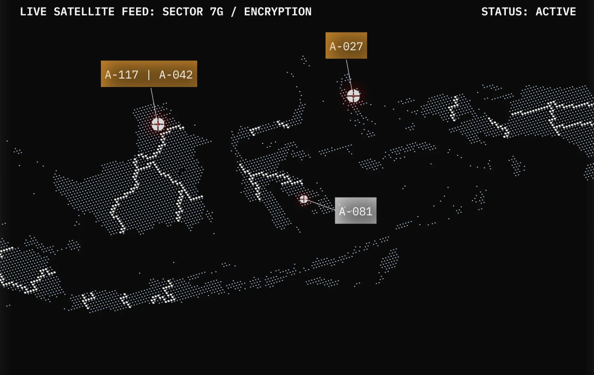

# Heimdall control panel design guide

Status: owner-approved design direction, updated 2026-11-26. Applies to every new panel page, component, interaction and change to existing UI under `web/`.

Use this as the visual source of truth for the control panel. Read it before designing or editing the panel. Preserve these choices as features grow; update the guide when the owner changes the direction. Product scope and behavior remain governed by the milestone documents, glossary and ADRs.

## Identity and owner preferences

Heimdall is a local SSH security workbench. Its owner should be able to see what happened, inspect evidence and change settings with confidence. The panel should feel like a carefully composed terminal instrument: precise typography, aligned text, dark consoles, visible structure and expressive technical art.

The owner **strongly prefers dark dotted graphics, TUI art and animations**. TUI means a text-based user interface; here, its character comes through monospace lettering, character drawings, brackets, lines and structured rows. These are part of Heimdall's identity, and should be actively considered when designing new features.

Keep the approved white-on-black pixel palette and JetBrains Mono. The earlier yellow and Tokyo Night themes have been superseded.

## Color and typography

| Role | Value | Use |
| --- | --- | --- |
| Canvas | `#000000` | Workspace, navigation and input surfaces |
| Panel | `#101010` | Monitor and sign-in surfaces |
| Rule | `#383838` | Quiet separators |
| Edge | `#808080` | Control outlines |
| Secondary | `#b3b3b3` | Supporting text |
| White | `#ffffff` | Primary text, pixel marks, focus and principal actions |

Use grayscale throughout. Indicate status with words and selection with a visible marker. Share the pixel gate between sign-in and Overview, with square-dot shading confined to the illustration. Use stepped pixel glyphs on principal actions.

Use **JetBrains Mono throughout**, including headings, forms, navigation, evidence and art. Serve the bundled Regular and Medium fonts from `web/static/fonts/`, retain their OFL license and keep a system monospace fallback. Fonts and graphics must load locally without a CDN or internet connection.

Use the current scale as the starting point: 32px desktop page headings, 26px on small screens, 14px body/navigation, and at least 12px for evidence and form explanations. Smaller metadata is an exception, never the default for important information. Prefer regular and medium weights, tabular digits and readable line spacing. Keep explanatory text below roughly 80 characters per line; wrap long log evidence without losing its content.

## Pages and layout

Each main task has its own page and URL. Keep Overview, Investigations, Activity and Settings as distinct destinations; new major tasks should follow the same pattern. Do not grow the panel into one long page of unrelated sections.

```text
Desktop
┌──────────────────┬───────────────────────────────────────┐
│ heimdall         │ Page title             Update state  │
│                  │                                       │
│ Overview         │ Current task                          │
│ Investigations   │ Evidence / controls / useful art      │
│ Activity         │                                       │
│ Settings         │                                       │
│                  │                                       │
│ Sign out         │                                       │
└──────────────────┴───────────────────────────────────────┘
```

Use a black navigation rail on desktop and a black workspace, with gray rules to distinguish consoles. On phones, navigation becomes a compact header with readable links, and split views stack vertically. Align content left; align related fields and log columns consistently. Preserve generous task-level spacing and compact spacing within related evidence.

Use real links, a visible current-page indicator and meaningful document titles. Direct loading, reload, login to the requested page and browser Back/Forward must work. Forms should warn before discarding unsaved edits.

## Dots, terminal art and technical illustrations



The reference establishes a visual language: a dark field, light point patterns forming recognizable shapes, monospace annotations, fine connecting lines and sparse markers. Its satellite labels and amber boxes are reference content, not Heimdall features or a new color scheme.

Preferred treatments include:

- Dotted or halftone shapes: forms built from small points, such as a gate, terrain, a host silhouette or a source diagram.
- ASCII and Unicode line art: original gate drawings, brackets, character-based diagrams and purposeful terminal framing.
- Fine contour lines, sparse grids and connector lines that organize a drawing or explain a relationship.
- Animated dot formations, line drawing, subtle character reveals and deliberate transitions between meaningful states.

Give a new page one deliberate art or motion treatment when it helps establish the task or explain a state. Login, empty states, monitor summaries and future visual explanations are good places for stronger artwork. Dense evidence tables and settings need quiet reading surfaces. Keep dots and scan textures inside art regions so they do not interfere with text, controls or focus outlines.

Create original assets with HTML/CSS, SVG or canvas when practical. Mark decorative artwork as decorative for assistive technology; meaningful graphics need a text explanation. Data-driven graphics must represent available records accurately. If an illustration is decorative or simulated, label it accordingly when it could be mistaken for live telemetry. A dotted world map does not imply geolocation, satellite coverage or a live network feed.

## Animation and interaction

Motion is welcome and should be designed intentionally. Prefer a small set of related effects across the panel:

- Sidebar links brighten on hover and show an outline on keyboard focus. The active page uses brighter, medium-weight text. Content links can draw a thin underline on hover and keyboard focus.
- Terminal art may form from dots or characters during one short entrance, then settle into a readable composition.
- Expanding evidence, saving settings and changing review status give clear, restrained feedback.

Start with the existing 160ms link transition; short interface transitions generally fit within 150–250ms. Artwork can use a longer reveal if it remains unobtrusive. Keep interface labels stable and readable during effects. Avoid flashing, repeated scrambling of evidence or ambient motion that competes with investigation.

Respect `prefers-reduced-motion`: replace movement with a static final composition and immediate state changes. Longer continuous artwork animations need a pause control, should stop when hidden and must not waste resources. A decorative animation must never imply that a stopped or unavailable monitor is active.

## Components and writing

Use thin rules, crisp controls, restrained corner rounding and strong light/dark contrast. Structure should explain relationships: timeline lines connect events, separators group settings and selected rows indicate the active investigation. Prefer this vocabulary over generic rounded cards, gradients, heavy shadows or unrelated decorative icons.

Use sentence case and plain action names such as “Save settings,” “Mark reviewed,” “Reopen alert” and “Download report.” Keep terms consistent with `GLOSSARY.md`: an Event is an observation; an Alert groups evidence with a rule match. Review status is separate from any source block.

Display live, synthetic, planned and unavailable states honestly. Empty states explain what can appear and the next useful step. Errors name the failed operation and a practical recovery action. Polling must preserve unsaved fields and keyboard focus while keeping selected evidence current. Session expiry and sign-out clear private content, including after browser-history restoration.

## Applying this guide

1. Read this guide and the existing panel before making UI changes. Identify the page, owner task, data source and required states.
2. Sketch the layout and choose the typography, palette roles and art/motion treatment. Check that it follows the approved direction before coding.
3. Reuse existing assets and component behavior. Keep any new assets local, licensed and compatible with the HTTP server's explicit asset allowlist.
4. Review the result at phone, tablet and desktop sizes. Check keyboard navigation, visible focus, text contrast, reduced motion, long evidence, empty/error states and any affected login or settings workflow.
5. Record which behavior is implemented, simulated or planned. For visual work, capture screenshots when browser review is available; report any checks that could not be performed.

Changes are ready when the new feature belongs visually to this panel, remains usable without artwork or animation, and preserves the affected owner workflows. This guide sets a continuing design standard; the dotted artwork and additional animation treatments above are preferred directions, not claims that they are already implemented everywhere.

## Reference lineage

- [Terminal typography and hover formation](https://webflow.com/made-in-webflow/website/hover-terminal-effect)
- [Dark terminal atmosphere](https://webflow.com/made-in-webflow/website/local-terminal)
- [Line hover interactions](https://webflow.com/made-in-webflow/website/20-link-effects)
- The image above was supplied by the owner as aesthetic inspiration. Its presence does not establish reuse rights for extracted third-party artwork; create original panel art.

The owner-approved choices in this guide take precedence over generic design-skill defaults. These references guide the visual language, not the product's capabilities.
